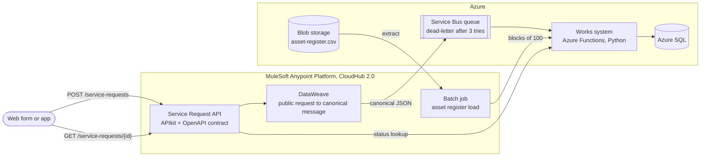

# Service request integration

A working integration between a public-facing service request API and a back-office works
management system, built on MuleSoft Anypoint Platform and Azure. A resident reports a
pothole. The request is checked against a contract, mapped to a canonical message, queued,
stored, and can be tracked. A nightly job loads the asset register from a messy CSV export.

Everything here is deployed and was tested end to end on 21 November 2026.



## What happens to a request

1. `POST /api/service-requests` arrives at the Mule application. APIkit rejects anything
   that does not match the [OpenAPI contract](api/service-request-api.yaml) with a `400`
   before any flow code runs.
2. DataWeave maps the public request to a [canonical message](mule/service-request-api/src/main/resources/dwl/to-canonical.dwl):
   it tidies text, normalises the suburb, and applies the
   [routing rules](mule/service-request-api/src/main/resources/modules/routing.dwl)
   (department, priority, target hours).
3. The message goes on an Azure Service Bus queue, with two retries. The caller gets a
   `202` receipt with a tracking id as soon as the message is safely queued.
4. An Azure Function picks the message up and stores it in Azure SQL with a `MERGE`, so a
   redelivered message never creates a duplicate.
5. A message that cannot be processed is retried three times, then Service Bus moves it to
   the dead-letter queue. Nothing is lost and someone can inspect it.
6. `GET /api/service-requests/{trackingId}` asks the works system and maps its record back
   to the public shape. Reporter details never leave the back office.

## The nightly load (ETL)

A [batch job](mule/service-request-api/src/main/mule/etl-asset-register.xml) runs at 02:00
Brisbane time, or on demand through `POST /api/data-loads/asset-register`.

- **Extract:** fetches `asset-register.csv` from blob storage with a read-only, one-file,
  seven-day token.
- **Transform:** [cleans and checks every row](mule/service-request-api/src/main/resources/dwl/asset-row.dwl):
  casing, spacing, two date formats, Queensland postcodes and coordinates. Impossible dates
  such as 31/02/2019 are rejected, not quietly moved.
- **Load:** sends good rows in blocks of 100. Each block is one set-based `MERGE`, so a
  block lands completely or not at all.
- **Report:** logs every rejected row with its reasons and records the run's counts.

The [sample file](data/asset-register.csv) is generated with a fixed seed: 250 rows, 12 of
them broken in 12 different ways.

## Where each skill shows up

| Area | Where to look |
| --- | --- |
| MuleSoft Anypoint Platform | [Mule application](mule/service-request-api): APIkit router, flows, batch job, error handling. Deployed to CloudHub 2.0, published to Exchange |
| API design | [OpenAPI 3 contract](api/service-request-api.yaml), one error shape for every failure |
| DataWeave | [Mappings and rules](mule/service-request-api/src/main/resources) |
| Azure Functions | [Works system](azure/functions): queue trigger and HTTP API in Python |
| ETL and data integration | [Batch job](mule/service-request-api/src/main/mule/etl-asset-register.xml), [SQL schema](azure/sql/schema.sql) |
| Messaging | Azure Service Bus queue with dead-lettering, defined in [Bicep](azure/infra/main.bicep) |
| Python and SQL | [Mapping rules with unit tests](azure/functions/works), `MERGE` and `OPENJSON` in [store.py](azure/functions/works/store.py) |
| Infrastructure as code | [Bicep template](azure/infra/main.bicep) for every Azure resource |
| Deployment pipeline | [Workflow](.github/workflows/build.yml): test, package, publish, deploy, smoke test |
| Documentation | This file, the contract, and comments that explain why |

## Security choices

- **No passwords in Azure.** The Function App reaches SQL, Service Bus and storage with its
  managed identity. The SQL server accepts Entra sign-in only.
- **No secrets in the repository or typed by a person at deploy time.** The pipeline signs
  in to Azure with OpenID Connect, [reads what the Mule app needs](scripts/mule-secrets.sh)
  and passes it to CloudHub as secured properties.
- **Least privilege.** MuleSoft holds a send-only key for one queue. The pipeline identity
  is trusted from the main branch of this repository only and is limited to one resource group.
- **Privacy in logs.** Logs carry tracking ids, correlation ids and routing. Reporter names,
  emails and phone numbers are never logged, and status lookups never return them.

## The pipeline

Every push to `main`:

1. Runs the Python unit tests and checks the sample data still has its expected rows.
2. Packages the Mule application. The Mule Maven plugin validates every flow at this step.
3. Signs in to Azure, reads the settings and secrets, publishes the release to Anypoint
   Exchange and deploys it to CloudHub 2.0.
4. Runs the [end-to-end smoke test](scripts/smoke_test.py) against the live API.

A weekly scheduled run redeploys and replaces the seven-day file token before it expires.

## What was checked

| Check | Result |
| --- | --- |
| Request accepted, queued, stored, and status read back through the API | Pass, in the pipeline on every deploy |
| Routing: a pothole goes to Roads and Drainage with a 48 hour target | Pass |
| Unknown category and missing reporter rejected with `400` | Pass |
| Unknown tracking id gives `404` | Pass |
| Status lookup never exposes the reporter | Pass |
| Asset register load: 250 rows in, 238 loaded, 12 rejected with reasons | Pass, counts match the generator |
| Poison message retried three times, then dead-lettered | Pass. This happened for real: the first run sent a double-encoded body |
| Mapping rules for the works system | 16 unit tests pass |

## Known gaps

Stated plainly so nobody has to find them:

- **No authentication on the API.** In production it would sit behind API Manager with
  client id enforcement and rate limiting, and the data-load endpoint would not be public.
- **No MUnit tests.** Running MUnit from Maven needs MuleSoft's enterprise repository, which
  a trial account does not have. The flows are covered by the end-to-end test instead.
- **Service Bus, not Kafka.** The messaging pattern is the same: publish, consume, retry,
  dead-letter.
- **Bicep, not Terraform,** and **GitHub Actions, not Azure DevOps.** The pipeline stages
  would carry over directly.
- **The pipeline deploys the Mule application only.** The Azure side is deployed with
  [one script](scripts/deploy-azure.sh) from a signed-in shell.
- **One environment.** There is no test or production stage and no promotion step.
- **The Service Bus connector's start-up check reports a failure.** It asks for
  namespace-level access, and the app deliberately holds a send-only key for one queue.
  Sending works.

## How it went

Every part was deployed and tested before it was called done. The first live runs failed
in several places, and each fix is its own commit.

## Run it yourself

```bash
# Azure side (from Azure Cloud Shell or any signed-in shell)
bash scripts/deploy-azure.sh

# One-off: give the pipeline its Azure identity, then add the Anypoint connected app
# id and secret as repository secrets ANYPOINT_CLIENT_ID and ANYPOINT_CLIENT_SECRET
bash scripts/setup-pipeline-identity.sh

# Works system unit tests
cd azure/functions && python -m pytest -q tests

# End-to-end check against a deployed API
python scripts/smoke_test.py --base-url https://<your-app-host>/api
```
